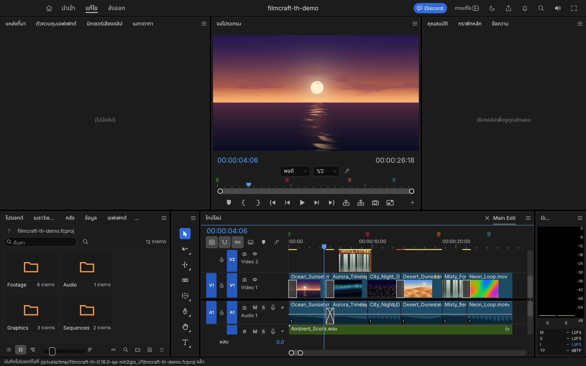
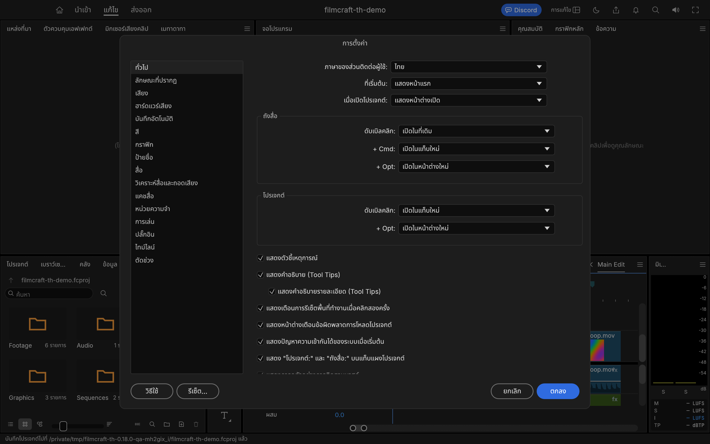
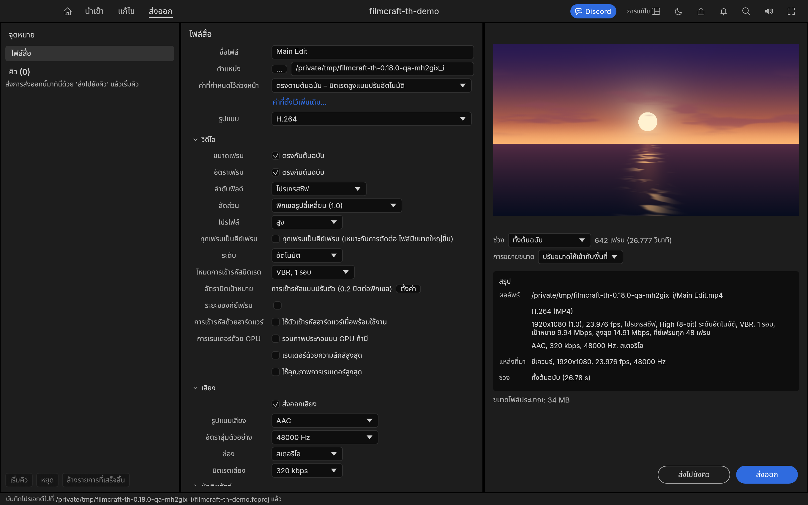

# FilmCraft TH — โปรแกรมตัดต่อวิดีโอภาษาไทย

**ดาวน์โหลดสำหรับ Mac Apple Silicon:** [FilmCraft TH 0.18.0-th.1 (.dmg)](https://github.com/tapanapon-com/filmcraft-th/releases/download/v0.18.0-th.1/FilmCraft-TH-0.18.0-th.1-macOS-arm64.dmg) · [รายละเอียดรุ่นและ SHA-256](https://github.com/tapanapon-com/filmcraft-th/releases/tag/v0.18.0-th.1)

**Windows 11 / 10 x64 — รุ่นใหม่ 0.18.0-th.1:** [ตัวติดตั้ง MSI](https://github.com/tapanapon-com/filmcraft-th/releases/download/v0.18.0-th.1/filmcraft-0.18.0-th.1-windows-x64.msi) · [Portable ZIP](https://github.com/tapanapon-com/filmcraft-th/releases/download/v0.18.0-th.1/filmcraft-0.18.0-th.1-windows-x64-portable.zip) · [คู่มือและ SHA-256](windows/README.md)

**รุ่นและผลตรวจ / Version and validation:** เอกสารนี้สำหรับ **0.18.0-th.1** ดูไฟล์ที่เผยแพร่และผลตรวจแยกตามแพลตฟอร์มใน [Releases](https://github.com/tapanapon-com/filmcraft-th/releases). This documentation targets **0.18.0-th.1**; consult its published assets and versioned validation for platform coverage.

แพ็กเกจ arm64 ไม่รองรับ Intel ลงนามแบบ ad-hoc และยังไม่ผ่าน Apple notarization ทดสอบเปิดจาก DMG บน macOS 26.3.1 แล้ว ดูข้อจำกัดและขั้นตอนติดตั้งใน [บทความภาษาไทยและอังกฤษบน Tapanapon.com](https://tapanapon.com/blog/filmcraft-th-thai-video-editor)


FilmCraft TH คือรุ่นปรับแต่งส่วนติดต่อภาษาไทยของ **[FilmCraft โดยทีม ArtCraft และผู้ร่วมพัฒนา](https://github.com/storytold/filmcraft)** โปรแกรมตัดต่อวิดีโอแบบ non-linear ที่พัฒนาด้วย Rust โครงการนี้เพิ่มภาษาไทยให้เมนู เครื่องมือ และการตั้งค่า โดยใช้ระบบตัดต่อเดิมของต้นฉบับ

> เป็นรุ่นดัดแปลงโดยชุมชน ไม่ใช่รุ่นภาษาไทยทางการจากทีม FilmCraft/ArtCraft ดูผลตรวจแยกตามแพลตฟอร์มใน [รายงานรุ่นนี้](docs/validation-0.18.0-th.1.json); ไม่ได้อ้างว่าทดสอบการตัดต่อผ่านหน้าจอ Windows ครบทุกแบบ



## รุ่นใหม่ 0.18.0-th.1 / What changed

- รวมซอร์สจาก tag **FilmCraft 0.18.0** พร้อมคำแปลไทยใหม่ 23 รายการ รวม **3,786 รายการ**
- รับการปรับ AAF, การอ่านคำบรรยาย TTML และการตรวจช่วงข้อมูล sample ใน MP4 จากต้นฉบับ ดู [Version Log พร้อมลิงก์ต้นทาง](docs/version-log.md)
- แพ็กเกจ Mac เพิ่ม `filmcraft-cli` สำหรับ MCP ไว้ใน `.app` เช่นเดียวกับแพ็กเกจ Windows
- ใช้ช่องทางตรวจอัปเดตของ `tapanapon-com/filmcraft-th` และเก็บเครดิต/สัญญาอนุญาตเดิม

Updated to the complete upstream **FilmCraft 0.18.0** tag. Added 23 translations, **3,786 Thai entries** total. Includes upstream AAF, TTML and MP4 sample-range changes. The Mac bundle now includes the MCP CLI alongside the GUI. See the [version log](docs/version-log.md) for source links and validation.

## ทำอะไรได้บ้าง

ความสามารถต่อไปนี้มาจาก FilmCraft ต้นฉบับ รุ่นนี้เพิ่มข้อความภาษาไทยให้ส่วนติดต่อ:

- **นำเข้าและจัดสื่อ** — จัดไฟล์ในถังสื่อ ดูภาพต้นฉบับ และวางคลิปลงซีเควนซ์
- **ตัดต่อบนไทม์ไลน์** — ใช้หลายแทร็กวิดีโอ/เสียง ตัดและเลื่อนคลิป ปรับจุดเข้า–ออก เพิ่มมาร์กเกอร์และทรานซิชัน
- **ภาพและสี** — ปรับเอฟเฟกต์ คีย์เฟรม สี และกราฟิก/ข้อความผ่านแผงเครื่องมือ
- **เสียง** — ปรับระดับเสียง มิกซ์เสียง และใช้เอฟเฟกต์เสียง
- **ส่งออก** — กำหนดรูปแบบวิดีโอ ขนาดภาพ อัตราเฟรม บิตเรต เสียง และจัดคิวการส่งออก ความพร้อมของแต่ละ codec ขึ้นกับระบบและตัวเข้ารหัส
- **ควบคุมด้วยคำสั่ง** — ต้นฉบับมี CLI, control API และ MCP ใช้รหัสคำสั่งเดิม จึงไม่ต้องเปลี่ยนสคริปต์ตามภาษาหน้าจอ

รายละเอียดความสามารถและข้อจำกัดต้นฉบับ: [README ของ FilmCraft](https://github.com/storytold/filmcraft#readme) · [สถาปัตยกรรม](docs/architecture.md)

## เริ่มใช้งาน

1. เปิด FilmCraft แล้วเลือก **แก้ไข → ภาษา → ไทย** หรือเลือกภาษาใน **การตั้งค่า → ทั่วไป**
2. สร้างหรือเปิดโปรเจกต์ `.fcproj` แล้วนำเข้าสื่อ
3. ลากคลิปลงไทม์ไลน์ ใช้เครื่องมือตัดต่อ ปรับเอฟเฟกต์และเสียงตามต้องการ
4. บันทึกโปรเจกต์ก่อนส่งออก โปรเจกต์เก็บโครงสร้างการตัดต่อและการอ้างอิงสื่อ จึงควรเก็บไฟล์สื่อไว้ด้วย
5. เปิดหน้า **ส่งออก** เลือกตำแหน่งไฟล์ รูปแบบ และช่วงเวลา จากนั้นส่งออกทันทีหรือส่งไปยังคิว

ภาพด้านล่างมาจากโปรเจกต์สาธิตที่ FilmCraft สร้างภาพและเสียงเอง ไม่ใช่งานส่วนตัวของผู้ใช้ ภาพรุ่น 0.18.0-th.1 ถ่ายจากแอปจริงและบีบอัด PNG แบบไม่เปลี่ยนขนาดหรือพิกเซล ดู [บันทึกการจับภาพ](docs/images/thai/capture-0.18.0-th.1.json)

### ตั้งค่าภาษาไทย



### ส่งออกวิดีโอ



## สิ่งที่รุ่นภาษาไทยเพิ่ม

- แค็ตตาล็อกภาษาไทย **3,786 รายการ** ครบคีย์ที่รวมจากแค็ตตาล็อกภาษาที่มีอยู่ ณ commit ฐาน
- ตัวเลือก `ไทย` และการจดจำภาษาหลังปิดแอป
- เมนู macOS และคำอธิบายสิทธิ์ไมโครโฟนภาษาไทย
- ตรวจความพร้อมฟอนต์ไทย ใช้ฟอนต์จากระบบ macOS
- ปรับข้อความหน้าส่งออก รวมทั้งสรุปวิดีโอ/เสียงและตัวเลือกเข้ารหัสฮาร์ดแวร์
- เครื่องมือตรวจคำแปล ตัวแปร รูปแบบข้อความ และทดสอบเปิดหน้าจอด้วยข้อมูลแยก

**ขอบเขต:** ชื่อไฟล์ ชื่อโปรเจกต์ ข้อมูลของผู้ใช้ รหัสคำสั่ง/API และชื่อมาตรฐานอย่าง H.264 ไม่ถูกแปล ข้อผิดพลาดแบบไดนามิกจาก engine/ระบบปฏิบัติการหรือไลบรารีภายนอกอาจยังเป็นอังกฤษ คำแปลใช้ AI ช่วยร่างและปรับศัพท์ในงานนี้ ยังไม่ได้ตรวจภาษาทุกประโยคโดยผู้ตรวจอิสระ และไม่ได้ทดสอบทุกฟังก์ชันของโปรแกรม

## ทำงานอย่างไร

ส่วนติดต่อ `ui-egui` ใช้ข้อความต้นฉบับเป็นคีย์ แล้วค้นคำแปลตามภาษาที่เลือกจาก `crates/ui-egui/src/i18n/th.tsv` หากไม่มีคีย์จะใช้ข้อความเดิม การตั้งค่าบันทึกค่า `th` ไว้ใน preferences เมนู native ใช้ภาษาเดียวกัน ส่วน engine, timeline และ codec ยังใช้โค้ดและรหัสคำสั่งเดิม

ไฟล์ที่เกี่ยวข้อง:

| ส่วน | ไฟล์ |
|---|---|
| คำแปล | [th.tsv](crates/ui-egui/src/i18n/th.tsv) |
| เลือกภาษาและค้นคำแปล | [i18n.rs](crates/ui-egui/src/i18n.rs) |
| เมนู Mac | [native_menu.rs](apps/filmcraft/src/native_menu.rs) |
| คำแปลที่ตรวจปรับ | [reviewed.tsv](tools/thai/reviewed.tsv) |
| ตรวจแค็ตตาล็อก | [validate_catalog.py](tools/thai/validate_catalog.py) |
| ทดสอบหน้าจอ | [smoke_macos.py](tools/thai/smoke_macos.py) |

## ติดตั้งจาก GitHub บน Mac หรือ Windows

GitHub Releases มี DMG สำหรับ Mac Apple Silicon และ MSI/portable ZIP สำหรับ Windows x64 ส่วน Source ZIP และ `git clone` เป็นซอร์สที่ต้องคอมไพล์ก่อนใช้งาน

**Mac:** ดาวน์โหลด DMG เปิดไฟล์แล้วลาก FilmCraft.app ไป Applications จากนั้นเปิดแอปและเลือกภาษาไทย

**Windows:** เปิด MSI และทำตามขั้นตอน หรือแตก portable ZIP ทั้งโฟลเดอร์แล้วเปิด `filmcraft.exe` โดยเก็บ `portable.txt` ข้างแอป

ตรวจ SHA-256 จาก release ก่อนติดตั้ง รุ่น Mac เซ็นแบบ ad-hoc และยังไม่ผ่าน Apple notarization ส่วน Windows ยังไม่มีลายเซ็น Authenticode

## สร้างและใช้งานบน Windows 11

ต้องมี Rust toolchain (MSVC) และ Python 3 (หากต้องการสร้างแพ็กเกจ MSI ต้องมี .NET SDK และ WiX v5: `dotnet tool install --global wix --version 5.0.2`):

```powershell
# ตรวจความถูกต้องของแค็ตตาล็อกคำแปลภาษาไทย
python tools/thai/validate_catalog.py

# คอมไพล์และเปิดใช้งานบน Windows
cargo run --release --locked -p filmcraft

# ตรวจสอบความถูกต้องของคำแปลด้วย test suite
cargo test --release --locked -p filmcraft-ui-egui --lib i18n::tests
```

### สร้างแพ็กเกจสำหรับ Windows 11 (.zip Portable และ .msi Installer)
สร้างไฟล์ติดตั้งและแพ็กเกจ Portable ได้ในคำสั่งเดียว:
```powershell
$env:FILMCRAFT_VERSION = "0.18.0-th.1"
pwsh packaging/windows/package.ps1 -Arch x64
```
จะได้ไฟล์ในโฟลเดอร์ `dist/release/`:
- `filmcraft-0.18.0-th.1-windows-x64-portable.zip` (แบบไม่ต้องติดตั้ง แตกไฟล์แล้วเปิด `filmcraft.exe` ได้ทันที)
- `filmcraft-0.18.0-th.1-windows-x64.msi` (ไฟล์ติดตั้ง Windows Installer เมื่อติดตั้ง WiX Toolset แล้ว)

### ทดสอบการทำงานอัตโนมัติบน Windows 11 (Smoke Test)
```powershell
python tools/thai/smoke_windows.py
```

## สร้างบน macOS

ต้องมี Rust toolchain, Xcode Command Line Tools และ Python 3 สำหรับสคริปต์ช่วย ดูการติดตั้ง dependency เพิ่มเติมใน [คู่มือผู้ร่วมพัฒนา](docs/contributing.md)

```sh
git clone https://github.com/tapanapon-com/filmcraft-th.git
cd filmcraft-th
python3 tools/thai/validate_catalog.py
cargo build --release --locked -p filmcraft -p filmcraft-cli
cargo run --release --locked -p filmcraft
```

สร้างแพ็กเกจ `.app` ด้วย `python3 tools/thai/package_macos.py` ได้ไฟล์ที่ `dist/thai/FilmCraft.app` สคริปต์ลงนามแบบ ad-hoc สำหรับใช้ในเครื่อง ไม่ใช่แอปที่ผ่าน Apple notarization และไม่ติดตั้งทับ Applications อัตโนมัติ ใช้ไอคอนจากซอร์สต้นฉบับโดยตรง จากนั้นสร้าง DMG ด้วย `python3 tools/thai/package_dmg.py` ซึ่งแนบ CLI และใบอนุญาตฟอนต์ไว้ด้วย

ตรวจภาษาและหน้าจอ:

```sh
cargo test --release --locked -p filmcraft-ui-egui --lib i18n::tests
python3 tools/thai/smoke_macos.py "$PWD/dist/thai/FilmCraft.app/Contents/MacOS/FilmCraft"
```

ไม่มีโมเดลแปลภาษา หรือ Python รวมอยู่ในแอปที่สร้างแล้ว การอัปเดตทับด้วยรุ่นทางการอาจแทนที่การปรับแต่งภาษาไทยนี้

ผลตรวจรุ่นปัจจุบัน: [validation-0.18.0-th.1.json](docs/validation-0.18.0-th.1.json) ส่วน [thai-validation.md](docs/thai-validation.md) เป็นรายงานรุ่นก่อนหน้า

## ต้นฉบับ เครดิต และสัญญาอนุญาต

- **โครงการต้นฉบับ:** [storytold/filmcraft](https://github.com/storytold/filmcraft) โดย ArtCraft และผู้ร่วมพัฒนา
- **commit ฐาน:** [`015d5b3ea37e1202a529e6245d3cc021c8c16ffd`](https://github.com/storytold/filmcraft/commit/015d5b3ea37e1202a529e6245d3cc021c8c16ffd) — รุ่นพื้นฐาน 0.18.0
- **README ต้นฉบับ ณ commit ฐาน:** [ดูบน GitHub ต้นฉบับ](https://github.com/storytold/filmcraft/blob/015d5b3ea37e1202a529e6245d3cc021c8c16ffd/README.md)
- **ข้อความร่วมภาษาไทย:** [storytold/craft-i18n](https://github.com/storytold/craft-i18n/tree/c199dc459eb3f1f105f87edaf5b0b1f8f32ca846/locales/th)
- โค้ดต้นฉบับและส่วนปรับแต่งภาษาไทยใช้ **MIT OR Apache-2.0** ตาม [LICENSE-MIT](LICENSE-MIT), [LICENSE-APACHE](LICENSE-APACHE) และ [NOTICE](NOTICE) โดยคงเครดิตเดิมไว้
- [LICENSE](LICENSE) ที่มีอยู่ใน repository ปลายทางยังคงไว้ ไม่แทนที่สิทธิ์และเครดิตของต้นฉบับ
- ภาพหน้าจอและสินทรัพย์มีเครดิตแยกใน [ATTRIBUTION.md](ATTRIBUTION.md) และไฟล์ `.attribution` ที่อยู่ข้างแต่ละไฟล์
- ชื่อ FilmCraft/ArtCraft ใช้เพื่ออ้างอิงที่มา รุ่นนี้ไม่อ้างว่าเป็นผลงานทางการหรือได้รับการรับรองจากผู้พัฒนาต้นฉบับ

## อัปเดตรุ่นไทย / Updating the Thai edition

ตรวจรุ่นใหม่จาก [Thai Releases](https://github.com/tapanapon-com/filmcraft-th/releases) และ [Version Log](docs/version-log.md) แล้วดาวน์โหลด DMG/MSI หรือ portable ZIP ที่ตรงกับเครื่อง บันทึกงานและปิดแอปก่อนแทนที่รุ่นเดิม ระบบ Check for Updates ของต้นฉบับยังคัดเฉพาะรุ่น stable จึงไม่แจ้งรุ่นไทยที่มีชื่อ `-th.1` อัตโนมัติ

For Thai updates, use this repository's Releases and Version Log, verify the checksum, save your work and quit the app before replacing the previous copy. Upstream's automatic checker excludes `-th.1` prereleases; automatic Thai updates are not currently supported.
